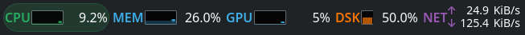

# KStats

KStats is a KDE Plasma 6 panel widget inspired by exelban/stats. The first
version focuses on a menu-bar style status strip with a click-to-open dropdown,
using CPU, memory, GPU, disk, and network readings from KDE's KSysGuard sensor API.

## Screenshots



<table>
  <tr>
    <td align="center"><strong>CPU</strong></td>
    <td align="center"><strong>Disk</strong></td>
    <td align="center"><strong>Network</strong></td>
    <td align="center"><strong>Memory</strong></td>
    <td align="center"><strong>GPU</strong></td>
  </tr>
  <tr>
    <td width="20%"></td>
    <td width="20%"></td>
    <td width="20%"></td>
    <td width="20%"></td>
    <td width="20%"></td>
  </tr>
</table>

## Install for the current user

```sh
kpackagetool6 --type Plasma/Applet --install .
```

After installing, add `KStats` from Plasma's widget picker.

For local testing without installing:

```sh
plasmoidviewer --applet .
```

For KDE store:
https://www.opendesktop.org/p/2364289/

## History and sensor availability

Choose a 1, 5, or 15 minute history window in the popup header or widget settings;
the default is 1 minute. Steady readings advance the graph, and unavailable
readings or collection pauses leave gaps. Changing the update interval does not
stretch older samples.

Enabled panel modules keep a rolling 15-minute history in memory, starting when
the widget loads, even before the popup first opens and after it closes or changes
tabs. This includes CPU user/system/idle history and utilization, memory, and
temperature histories for every discovered GPU when the GPU module is enabled.
The panel GPU selector only chooses which device appears in the panel.

A module disabled in the panel collects history while its detail page is open
and may pause when hidden. CPU core bars and other values without history remain
demand-driven. The 1, 5, or 15 minute selector changes only the visible range;
it does not change collection or clear retained samples. History cannot backfill
time before the widget starts or while collection is paused, and restarting the
widget clears it.

Missing or stale sensor readings show `N/A`; an actual zero remains a valid
reading. Sensor monitoring retries after backend failures without changing the
configured sensor or GPU selection.

## Panel tooltips and disk activity

Hovering a panel module shows a tooltip for that module only: CPU usage with its
user/system split, memory usage with used and total bytes, GPU usage, memory and
temperature, disk usage with read/write rates, or network rates with their source.

The Disk page charts the configured read and write sensors (`disk/all/read` and
`disk/all/write` by default) using the same history window. Linux serves most
reads from memory, so read activity is often near zero even while applications
read files, while writes still reach the disk. Per-disk rows show each physical
disk's current rate.

## Network source

Choose `Network source` in the widget settings. The panel, popup, tooltip, and
history always measure the same source, and the popup names it:

- **All interfaces (combined)**: the default. KDE's aggregate of every interface;
  virtual and VPN interfaces can count the same traffic more than once.
- **Automatic (default route)**: the interface used by the default IPv4 route,
  or IPv6 when there is none, rechecked every 10 seconds. It shows `N/A` when no
  route resolves instead of guessing another interface.
- **A specific interface**: always measured, even while disconnected.
- **Custom sensor IDs**: uses the `Network down` and `Network up` sensor IDs.
  Configurations from earlier versions with non-default network sensor IDs keep
  working as Custom.

Interfaces come from KSystemStats, which lists the interfaces it monitors (with
NetworkManager, the managed ones). Changing the source starts a new history
series. The popup details describe the measured interface, or the default-route
interface for combined and custom sources.

### Public IP

Public IP lookup is off by default. Turn it on with `Public IP` in the widget
settings or the `Look up via ipify.org` button on the Network page. When enabled,
KStats sends one HTTPS request to `api64.ipify.org` when the Network page opens
and when you press Refresh; it never polls in the background. The service sees
your public IP address. The result describes the route to that service, including
any VPN or proxy, and is not tied to the network source above. A failed or
timed-out lookup keeps the previous result, dimmed, until you refresh. Turning the
setting off clears it.

## Development checks

Run the QML behavior tests with Qt 6 Quick Test installed:

```sh
QT_QPA_PLATFORM=offscreen QT_QUICK_BACKEND=software \
    /usr/lib/qt6/bin/qmltestrunner -input tests
```

The fixtures use controlled inputs to exercise sensor states and history without
requiring live monitoring hardware. Adjust the Qt tool path for your distribution.
CI also checks QML, configuration XML, metadata, and package installation. Live
Plasma checks remain necessary for hardware recovery and panel/popup behavior.

## GPU monitoring

Enable `GPU: Show in bar` in the widget settings and choose a `Panel GPU`.
The panel shows utilization and a sparkline. Click it to open usage, memory,
and temperature readings for the detected GPUs. GPU display is off by default.

The selector, expanded view, and tooltip show model names when available.
KDE's names take priority; generic labels can fall back to the local PCI hardware
database through `udevadm`. If the devices cannot be matched, the generic labels
remain. Hardware database names may describe a family of cards rather than an
exact model.

Unavailable readings show `N/A` without changing the panel width. Monitoring
retries automatically and keeps the selected GPU. KDE device IDs (`gpu0`,
`gpu1`, etc.) may change after hardware changes; check the selection afterward.

Readings depend on KDE's KSystemStats service and the installed driver:

- AMD: utilization and VRAM use the `amdgpu` driver; temperature depends on
  available hardware sensors
- Nvidia: requires a working `nvidia-smi` installation; Nouveau is not supported
  by KDE's Nvidia backend
- Intel: `i915` utilization requires KSystemStats 6.4 or later and the distro's
  `ksystemstats_intel_helper` with `CAP_PERFMON`; separate `xe` support is
  targeted for Plasma 6.8 and depends on distro build support

Check the same sensors in Plasma System Monitor when troubleshooting. KDE can
report zero for unsupported metrics, and integrated GPU memory may not include
all shared system memory available to the GPU.

See [KDE's GPU backend](https://invent.kde.org/plasma/ksystemstats/-/tree/master/plugins/gpu),
[Intel helper packaging](https://community.kde.org/Distributions/Packaging_Recommendations#Ksystemstats_package_configuration),
and the [Intel Xe announcement](https://blogs.kde.org/2026/05/23/this-week-in-plasma-xe-driver-support-and-polishing-discover/).

## Scope

Implemented:

- compact panel representation
- Stats-like expanded dropdown with CPU, GPU, NET, and DISK tabs
- CPU, memory, disk, network sensors, plus optional GPU utilization in the panel
- CPU model plus auto-discovered CPU temperature and fan sensors
- configurable sensor IDs and update interval
- per-module panel tooltips
- disk read/write activity history and a shared network source
- auto-discovered GPU usage, memory, and temperature sensors

Not implemented yet:

- voltage and power sensors

Those require hardware-specific Linux backends or deeper integration with KDE's
sensor browser and should be added after the basic widget is stable.
